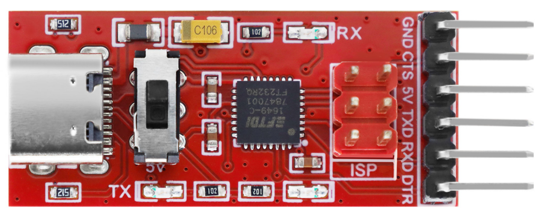
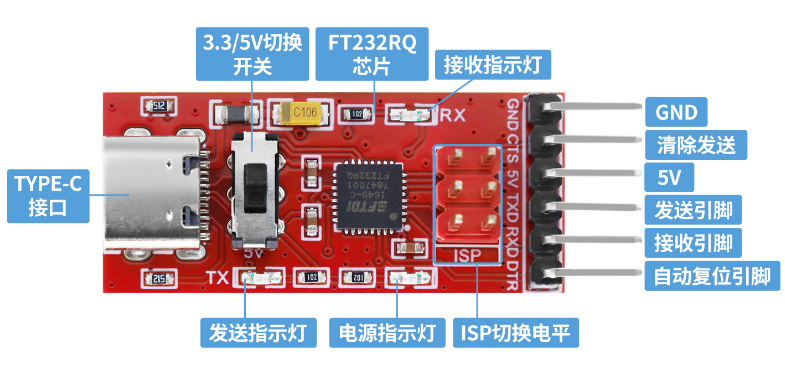
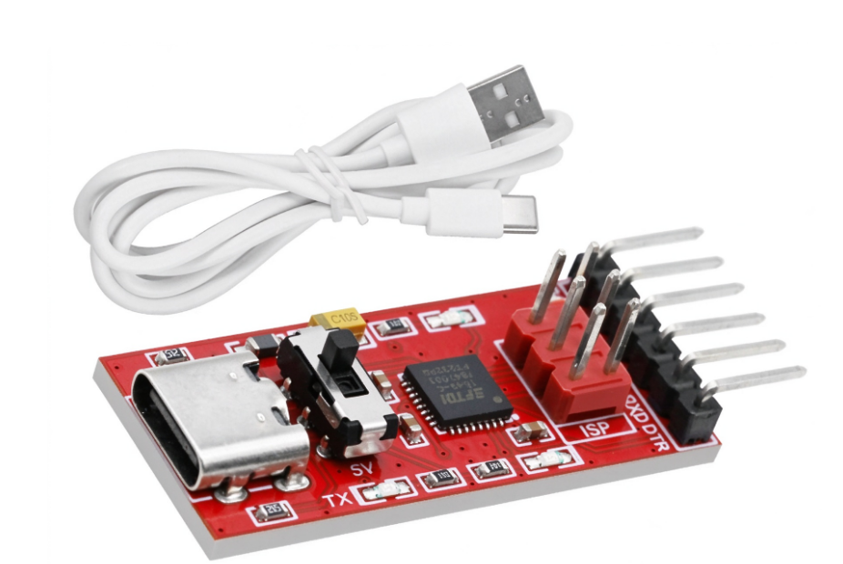

# MD0849 FTDI Basic程序下载器 红色环保（中性） FT232RQ

## 1. 产品简介
随着计算机技术发展，老式并行口、RS232串口已经在现代电脑（含台式机）上逐步消失。但硬件调试、固件烧录场景中，串口依然是工程师及DIY爱好者最常用的接口。对于没有原生串口的电脑，可以借助USB转串口芯片，通过USB虚拟出串口设备。

市面上常见USB转UART芯片：
- 芯科 CP210x 系列
- TI TUSB3410
- 南京沁恒 CH34x 系列
- FTDI FT232 系列
- Prolific PL230x 系列
- ARK3116 等

其中 **FTDI FT232RQ 芯片稳定性优秀**，串口通信可靠，不容易出现电脑蓝屏问题。

FTDI Basic程序下载器 模块是以 **FT232RQ** 为核心的USB转TTL串口适配器。板载拨码开关，可切换 **3.3V / 5V** 串口逻辑电平。标准排针引脚，TYPE-C USB接口，完美适配 UNO、ESP32、STC 等设备上传程序。

## 2. 产品参数与特性

- 标准排针接口，兼容多款 Arduino 主控
- FT232RQ芯片，通信稳定可靠
- 板载电源指示灯 + TX/RX收发指示灯，方便查看通信状态
- 硬件拨码开关：切换3.3V / 5V TTL逻辑电平
- 多功能：通用USB转TTL串口；支持STC单片机程序下载
- 物理尺寸：17 x 42 x 10mm

### 引脚定义
| 引脚 | 说明 |
|---|---|
| GND | 电源地 |
| CTS | 清除发送（硬件流控） |
| 5V | 5V电源输出 |
| TXD | 模块发送（模块 → 目标设备） |
| RXD | 模块接收（目标设备 → 模块） |
| DTR | 数据终端就绪 |

> ⚠️ 注意：拨码开关电平必须和目标单片机逻辑电压保持一致。3.3V单片机切3.3V，5V单片机切5V，电平不匹配可能烧毁芯片。

## 3. 包装清单

| 物品 | 数量 |
|---|---|
| FTDI Basic程序下载器 红色环保（中性） FT232RQ | 1块 |
| TYPE-C 数据线 | 1根 |

## 4. 常见驱动问题排查
1. **设备管理器黄色感叹号**
    - 驱动版本不匹配；尝试更换最新版FTDI VCP驱动
    - USB线损坏：部分TYPE-C USB线只有充电功能，没有数据传输功能，需要使用套件自带数据线
2. **驱动安装成功，但找不到COM口**
    - 换电脑后置USB口，避免USB集线器供电不足
    - 重启电脑，重新插拔模块
3. **串口频繁掉线**
    - 确认没有安装第三方冲突USB转串口驱动
